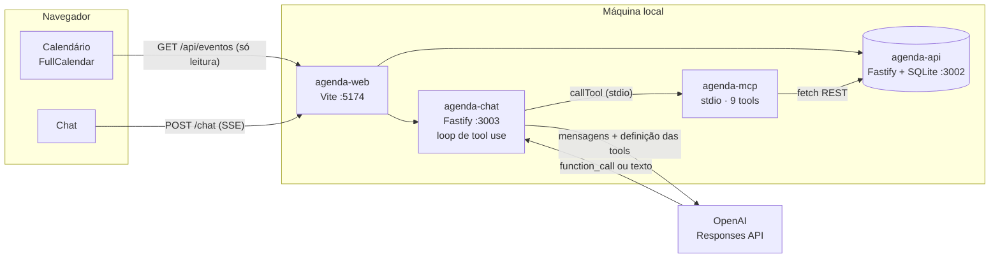
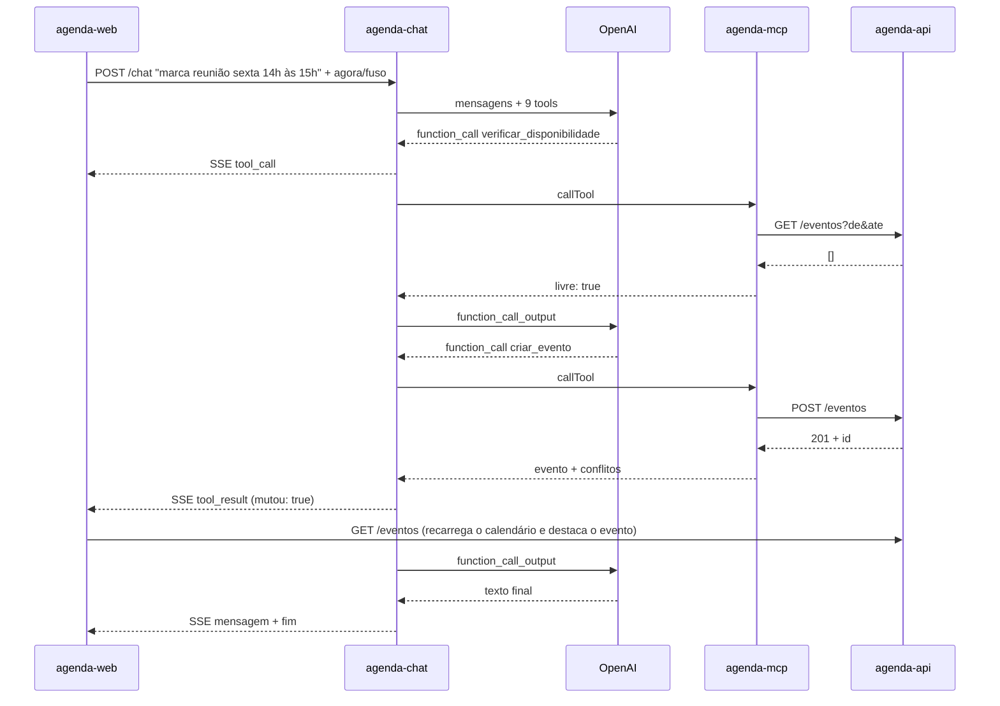

# mcp-poc · Agenda via MCP

Prova de conceito de um **MCP server** (Model Context Protocol) que transforma uma API REST de
agenda em *tools* para agentes de IA, mais um **frontend de calendário com chat** em que o
usuário escreve em linguagem natural ("marca jiu-jitsu seg, qua e sex 19h30 até o fim do ano")
e o assistente executa as ações chamando essas tools.

O mesmo MCP server funciona em três lugares, sem mudar uma linha:

- no **chat web** deste repositório (OpenAI + MCP Client próprio);
- no **Claude Code** (`claude mcp add …`);
- no **MCP Inspector**.


## Sumário

- [Arquitetura](#arquitetura)
- [Início rápido](#início-rápido)
- [Pacotes](#pacotes)
- [API REST (`agenda-api`)](#api-rest-agenda-api)
- [MCP server (`agenda-mcp`)](#mcp-server-agenda-mcp)
- [Chat (`agenda-chat` + `agenda-web`)](#chat-agenda-chat--agenda-web)
- [Usar no Claude Code e no MCP Inspector](#usar-no-claude-code-e-no-mcp-inspector)
- [Pedidos para testar](#pedidos-para-testar)
- [Testes](#testes)
- [Configuração](#configuração)
- [Decisões de projeto](#decisões-de-projeto)
- [Limitações e próximos passos](#limitações-e-próximos-passos)

## Arquitetura

O navegador não fala com o MCP diretamente: o MCP server roda em **stdio** (um subprocesso
local), e quem decide qual tool chamar é um LLM. Por isso existe um backend de chat no meio.



Um pedido do começo ao fim:



## Início rápido

**Pré-requisitos:** Node **22** (`nvm use`; ver `.nvmrc`), pnpm 10 e uma chave da OpenAI.

```bash
pnpm install
cp .env.example .env      # defina OPENAI_API_KEY (ou OPENAI_ENV_FILE)
pnpm dev                  # sobe api (:3002), chat (:3003) e web (:5174)
pnpm seed                 # em outro terminal: 3 eventos de exemplo
open http://localhost:5174
```

O `.npmrc` fixa `use-node-version=22.22.2`: os scripts `pnpm …` rodam nesse Node mesmo que o
Node padrão do shell seja outro (o pnpm baixa a versão na primeira execução).

| Script           | O que faz                                                             |
|------------------|-----------------------------------------------------------------------|
| `pnpm dev`       | API + chat + web em paralelo, em watch                                |
| `pnpm dev:api`   | só a API em `http://127.0.0.1:3002` (banco `agenda.db`)               |
| `pnpm dev:chat`  | só o backend do chat em `:3003` (precisa da chave da OpenAI)          |
| `pnpm dev:web`   | só o frontend em `http://localhost:5174`                              |
| `pnpm dev:mcp`   | o MCP server em stdio (é o que o Claude Code executa)                 |
| `pnpm seed`      | cria 3 eventos relativos a hoje, via HTTP (a API precisa estar no ar) |
| `pnpm inspect`   | abre o MCP Inspector apontando para o server                          |
| `pnpm test`      | testes de todos os pacotes                                            |
| `pnpm typecheck` | `tsc` em todos os pacotes                                             |

## Pacotes

```
packages/
  agenda-api/    API REST de agenda (Fastify + SQLite)            → "a API que já existia"
  agenda-mcp/    MCP server em stdio, wrapper fino sobre a API    → o foco da POC
  agenda-chat/   backend do chat: OpenAI + MCP Client + SSE
  agenda-web/    React + Vite: calendário + chat
```

| Pacote        | Arquivos principais                                                                                                  |
|---------------|----------------------------------------------------------------------------------------------------------------------|
| `agenda-api`  | `schemas.ts` (Zod, exportado para reuso), `repositorio.ts` (SQL), `app.ts` (rotas e erros), `seed.ts`                 |
| `agenda-mcp`  | `tools.ts` (CRUD + disponibilidade), `tools-lote.ts` (lote e recorrência), `recorrencia.ts`, `api-client.ts`, `index.ts` (stdio) |
| `agenda-chat` | `agente.ts` (loop de tool use e confirmação), `app.ts` (HTTP + SSE), `mcp.ts` (sobe o MCP como subprocesso), `config.ts` |
| `agenda-web`  | `Calendario.tsx`, `Chat.tsx`, `chatClient.ts` (POST + leitura do stream SSE)                                          |

O `agenda-mcp` importa da API só os schemas e tipos (`@agenda/api/schemas`), como faria com um
pacote de contrato publicado. Toda a regra de negócio fica na API.

**Stack:** TypeScript strict, pnpm workspaces, Zod 4, Fastify 5, better-sqlite3, Vitest,
`@modelcontextprotocol/sdk` 1.32 (`registerTool`), `openai` 7 (Responses API), React 19,
FullCalendar 6, Vite 8.

## API REST (`agenda-api`)

Entidade `Evento`: `id` (uuid), `titulo`, `descricao` (opcional), `inicio`, `fim`, `criadoEm`,
`atualizadoEm`.

| Método | Rota                    | Notas                                                                                  |
|--------|-------------------------|----------------------------------------------------------------------------------------|
| GET    | `/eventos?de=&ate=`     | eventos que se sobrepõem a `[de, ate)`; filtros opcionais; ordenado por início         |
| GET    | `/eventos/:id`          | 404 `Evento não encontrado com id X`                                                   |
| POST   | `/eventos`              | 201; 400 com `erro` e `detalhes[]`                                                     |
| PATCH  | `/eventos/:id`          | parcial; `descricao: null` limpa; valida `fim > inicio` depois do merge                |
| DELETE | `/eventos/:id`          | 204                                                                                    |
| POST   | `/eventos/lote`         | `{ eventos: [...] }` → 201 `{ eventos }`; atômico; erro com índice (`eventos.3.fim`)    |
| POST   | `/eventos/lote/remover` | `{ ids: [...] }` → `{ removidos }`; atômico; 404 lista os ids inexistentes             |

**Datas:** ISO 8601 **com timezone** (`Z` ou `±hh:mm`, segundos obrigatórios), ex.:
`2026-11-20T15:00:00-03:00`. O offset enviado é preservado na resposta; as comparações usam o
instante (epoch), então `17:00Z` e `14:00-03:00` são o mesmo horário. Os intervalos são
semiabertos: um evento das 14h às 15h não conflita com outro das 15h às 16h.

**Erros legíveis**, pensados para chegar ao modelo sem tradução:

```bash
curl -s -XPOST localhost:3002/eventos -H 'content-type: application/json' \
  -d '{"titulo":"x","inicio":"2026-11-20T15:00:00-03:00","fim":"2026-11-20T14:00:00-03:00"}'
# {"erro":"Dados inválidos — fim: fim deve ser depois de inicio",
#  "detalhes":[{"campo":"fim","mensagem":"fim deve ser depois de inicio"}]}
```

A API **permite** eventos sobrepostos. Quem detecta conflito é o MCP
(`verificar_disponibilidade`), e as tools de criação devolvem `conflitos` como aviso.

## MCP server (`agenda-mcp`)

Transporte stdio. A URL da API vem de `AGENDA_API_URL` (padrão `http://localhost:3002`).

| Tool                        | Annotations                                | Saída (`structuredContent`)          |
|-----------------------------|--------------------------------------------|--------------------------------------|
| `listar_eventos`            | `readOnlyHint`                             | `{ de, ate, total, eventos[] }`      |
| `buscar_evento`             | `readOnlyHint`                             | `{ evento }`                         |
| `verificar_disponibilidade` | `readOnlyHint`                             | `{ livre, de, ate, conflitos[] }`    |
| `criar_evento`              | `destructiveHint: false`                   | `{ evento, conflitos[] }`            |
| `atualizar_evento`          | `destructiveHint: false`, `idempotentHint` | `{ evento, conflitos[] }`            |
| `remover_evento`            | `destructiveHint: true`, `idempotentHint`  | `{ removido: true, evento }`         |
| `criar_eventos_recorrentes` | `destructiveHint: false`                   | `{ total, eventos[], conflitos[] }`  |
| `criar_eventos_em_lote`     | `destructiveHint: false`                   | `{ total, eventos[], conflitos[] }`  |
| `remover_eventos_em_lote`   | `destructiveHint: true`, `idempotentHint`  | `{ removidos }`                      |

Princípios das tools:

- **A description é o prompt.** Cada uma diz quando usar, o formato de data com exemplo, como
  converter "amanhã"/"sexta", e qual tool vem antes (ex.: "descubra o id com `listar_eventos`").
  O server também manda `instructions` gerais na inicialização.
- **Sempre devolver ids**, no texto e no `structuredContent`, para o modelo encadear ações.
- **Erro vira `isError: true` com mensagem acionável**, nunca stack trace: `Evento não encontrado
  com id X. Use listar_eventos para encontrar o id correto.`, ou `Não foi possível conectar à API
  de agenda em … Verifique se ela está rodando (pnpm dev:api)`.
- **Validação antes da API:** data sem timezone ou id que não é UUID nem chega a fazer `fetch`.
- **Resposta dupla:** `structuredContent` (validado por `outputSchema`) e um `text` com resumo
  legível + JSON, para clientes que só leem texto.
- **Lote em vez de repetição:** séries e listas são uma única chamada. `criar_eventos_recorrentes`
  recebe dias da semana, horário e período, e o próprio server gera as datas. Antes disso, o
  modelo criava uma ocorrência por tool call e estourava o limite de passos do chat.

## Chat (`agenda-chat` + `agenda-web`)

### Backend (`agenda-chat`, porta 3003)

1. Na inicialização, sobe o `agenda-mcp` como **subprocesso stdio** (o mesmo Node, via
   `--import tsx`), chama `listTools` e converte cada tool em *function tool* da OpenAI
   (`inputSchema` → `parameters`), guardando as annotations.
2. A cada mensagem, chama `responses.create` com o histórico, as instruções (com a data, a hora
   e o fuso do navegador) e as tools, com `parallel_tool_calls: false`.
3. Se vier `function_call`, executa `callTool` no MCP, acrescenta um `function_call_output` e
   repete. Se vier texto, termina. O limite é de 20 passos; se estourar, o que já foi feito
   fica salvo e o usuário pode dizer "continue".
4. Cada passo vai ao navegador por **SSE**.

| Evento SSE    | Quando                                                                     |
|---------------|----------------------------------------------------------------------------|
| `inicio`      | abre o stream; traz o `conversaId`                                         |
| `tool_call`   | o modelo pediu uma tool (nome + argumentos)                                |
| `tool_result` | resultado; `mutou: true` quando a tool não é `readOnlyHint`                |
| `confirmacao` | a tool tem `destructiveHint`: o loop pausa e espera o usuário              |
| `mensagem`    | resposta final em texto                                                    |
| `erro`        | erro legível (ex.: chave recusada, 429)                                    |
| `fim`         | fecha o stream                                                             |

**Confirmação humana, guiada pelas annotations do MCP:** quando o modelo chama uma tool
destrutiva (`remover_evento`, `remover_eventos_em_lote`), o backend não executa. Ele descreve a
ação com dados reais, buscados por tools de leitura (ex.: `Remover 18 evento(s): 18× “Jiu-jitsu”
(sex., 20/11 → qua., 30/12)`), e espera `POST /chat/confirmar`. Cancelar, ou mandar outra
mensagem no lugar, devolve ao modelo um `function_call_output` dizendo que a ação **não** foi
executada.

Rotas: `POST /chat` (`{ conversaId?, texto, agora, fuso }`), `POST /chat/confirmar`
(`{ conversaId, callId, aprovado, agora, fuso }`) e `GET /chat/health` (`{ ok, modelo }`).

### Frontend (`agenda-web`, porta 5174)

- **Calendário** (FullCalendar, dia/semana/mês, pt-BR) que lê `GET /eventos` direto da API, só
  para exibir. Toda ação passa pelo chat.
- **Chat** com cada tool chamada visível ("Consultou a agenda · sex, 20/11 · 3 eventos"), que
  expande para mostrar argumentos e resultado; um cartão de confirmação para ações destrutivas;
  e sugestões de pedidos.
- Quando uma tool altera a agenda, o calendário **recarrega**, navega até a data e **destaca** o
  evento.
- **Arrastar** no calendário preenche "Marca um evento sex, 21/11 das 14h às 15h: ".
  **Clicar** num evento preenche "Sobre “Daily” (…): ".
- O Vite faz proxy de `/api` → `:3002` e de `/chat` → `:3003`, então não há CORS.

## Usar no Claude Code e no MCP Inspector

**Claude Code** (com a API rodando):

```bash
claude mcp add agenda -e AGENDA_API_URL=http://localhost:3002 -- pnpm --dir /caminho/para/mcp-poc dev:mcp
```

Confira com `claude mcp list` ou `/mcp`. O pnpm não polui o stdout, então o JSON-RPC funciona
pelo `pnpm --dir`.

**MCP Inspector:**

```bash
pnpm inspect                                   # UI web; o Inspector imprime a URL com token
pnpm exec mcp-inspector --cli -e AGENDA_API_URL=http://localhost:3002 \
  tsx packages/agenda-mcp/src/index.ts --method tools/list
```

O Inspector não herda o env do shell; o script `inspect` repassa `AGENDA_API_URL` via `-e`.

## Pedidos para testar

| Pedido                                                        | Fluxo esperado                                                    |
|---------------------------------------------------------------|-------------------------------------------------------------------|
| "o que tenho amanhã?"                                         | `listar_eventos` (00:00 de amanhã → 00:00 do dia seguinte)        |
| "estou livre amanhã ao meio-dia?"                             | `verificar_disponibilidade` → ocupado pelo "Almoço com cliente"   |
| "marca reunião sexta 14h às 15h"                              | `verificar_disponibilidade` → `criar_evento`                      |
| "marca call amanhã 13h às 14h"                                | cria e avisa o conflito com o almoço                              |
| "muda a reunião de sexta para 16h"                            | `listar_eventos` → `atualizar_evento` com `inicio` e `fim`        |
| "jiu-jitsu toda seg, qua e sex 19h30 às 20h30 até 31/12"      | `criar_eventos_recorrentes` (uma chamada, ~18 eventos)            |
| "cancela o almoço com cliente"                                | `listar_eventos` → confirmação → `remover_evento`                 |
| "remove todos os jiu-jitsu"                                   | `listar_eventos` → uma confirmação → `remover_eventos_em_lote`    |

## Testes

```bash
pnpm test        # 66 testes: api 27 · mcp 23 · chat 16
pnpm typecheck
```

| Pacote        | Como                                                                                   | Cobre                                                                                                        |
|---------------|----------------------------------------------------------------------------------------|--------------------------------------------------------------------------------------------------------------|
| `agenda-api`  | `app.inject` (Fastify) + SQLite `:memory:`                                              | criação válida, fim antes/igual ao início, 400 legível, 404, sobreposição (parcial, borda, fusos diferentes), PATCH com merge, lote atômico |
| `agenda-mcp`  | `Client` do SDK + `InMemoryTransport`, `fetch` mockado                                  | catálogo e annotations, criação, conflito, inexistente, id inválido, API fora do ar, recorrência (expansão, limite, compactação), lote |
| `agenda-chat` | OpenAI mockada (roteiro de respostas) + MCP real em memória + API real em memória        | conversão das tools, loop leitura/escrita, erro de tool, JSON inválido, limite de passos, confirmação (aprovar, cancelar, nova mensagem cancela), lote, SSE, erro 401 |

O frontend é validado com `typecheck` e build, e foi testado de ponta a ponta no navegador.

## Configuração

O `.env` da raiz é opcional e gitignored; ver `.env.example`.

| Variável                  | Usado por          | Padrão                   | O que é                                                                |
|---------------------------|--------------------|--------------------------|------------------------------------------------------------------------|
| `OPENAI_API_KEY`          | chat               | —                        | chave da OpenAI                                                        |
| `OPENAI_ENV_FILE`         | chat               | —                        | alternativa: caminho de outro `.env`; só a `OPENAI_API_KEY` é lida dele |
| `OPENAI_MODEL`            | chat               | `gpt-5.5`                | modelo da Responses API                                                |
| `OPENAI_REASONING_EFFORT` | chat               | `low`                    | `minimal` · `low` · `medium` · `high`                                  |
| `AGENDA_API_URL`          | mcp, chat, web, seed | `http://localhost:3002` | URL da agenda-api                                                      |
| `PORT` / `HOST`           | api                | `3002` / `127.0.0.1`     |                                                                        |
| `AGENDA_DB`               | api                | `agenda.db`              | caminho do SQLite (`:memory:` funciona)                                |
| `CHAT_PORT`               | chat               | `3003`                   |                                                                        |
| `WEB_PORT`                | web                | `5174`                   |                                                                        |
| `SEED_OFFSET`             | seed               | `-03:00`                 | fuso dos eventos de exemplo                                            |

## Decisões de projeto

- **MCP como wrapper fino.** Validação e regra ficam na API. O MCP traduz para tools, melhora as
  mensagens para o modelo e só tem lógica própria onde ela é de interface com o agente:
  detecção de conflito, expansão de recorrência e compactação de listas longas.
- **Sobreposição permitida na API.** Agenda real tem conflitos; o agente avisa em vez de
  bloquear.
- **Recorrência sem regra persistida.** `criar_eventos_recorrentes` gera eventos independentes
  com offset fixo (o Brasil não tem horário de verão desde 2019). Guardar regras (RRULE) ficou
  fora do escopo.
- **Confirmação no cliente MCP, guiada por `destructiveHint`.** O server declara o risco e quem
  hospeda o agente decide como confirmar. Aqui, um cartão no chat.
- **Uma tool por vez** (`parallel_tool_calls: false`): simplifica a pausa para confirmação e
  deixa o histórico linear.
- **Node 22.** As versões atuais de Fastify (light-my-request), Vite/Vitest e do Inspector
  precisam de `require(esm)` / Node ≥ 22. O Node 20 está fora de suporte desde abril de 2026.
- **Inspector fixado em 2.13.0:** a 2.14 em diante exige Node ≥ 22.23.4.

## Limitações e próximos passos

- Conversas do chat ficam em memória: reiniciar o `agenda-chat` zera o histórico.
- Sem auth e sem multiusuário; transporte do MCP só em stdio.
- O texto da resposta chega inteiro (streaming por token ainda não implementado).

**TODO: expor o MCP via HTTP com OAuth**

- **Transporte:** trocar `StdioServerTransport` por Streamable HTTP
  (`StreamableHTTPServerTransport`) num endpoint `/mcp`; decidir entre stateless e sessões com
  `Mcp-Session-Id`; validar `Origin` (DNS rebinding); servir só por HTTPS.
- **OAuth 2.1 (spec de autorização do MCP):** o MCP server vira *resource server*; publicar
  `/.well-known/oauth-protected-resource` (RFC 9728); responder `401` com `WWW-Authenticate`;
  validar o bearer em cada request (assinatura, expiração, `aud`/resource indicator RFC 8707);
  PKCE; registro de cliente via Client ID Metadata Documents ou Dynamic Client Registration.
- **Escopos por tool:** `agenda:read` (listar/buscar/verificar) e `agenda:write`
  (criar/atualizar/remover).
- **Sem token passthrough:** não repassar o token do cliente MCP à API; usar token exchange ou
  credencial própria, propagando a identidade do usuário.
- **Multiusuário na API:** `owner_id` nos eventos, filtro por usuário em todas as queries.
- **Operação:** rate limit, auditoria das tools destrutivas, health check, retries e deploy.
