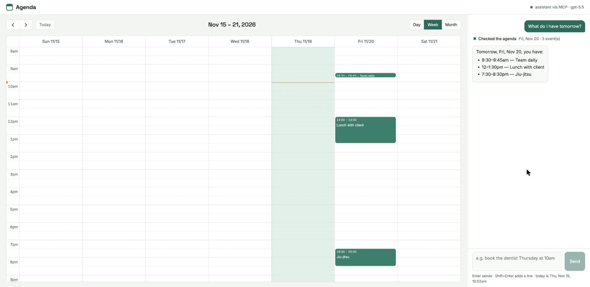
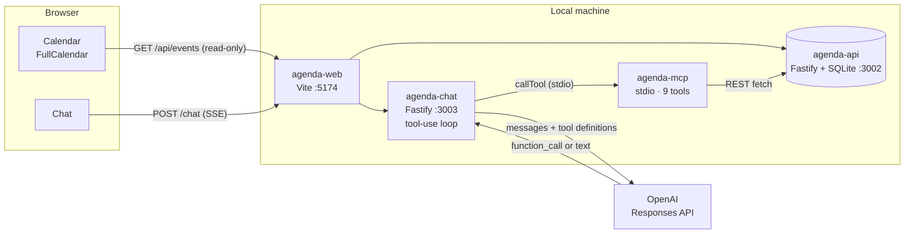
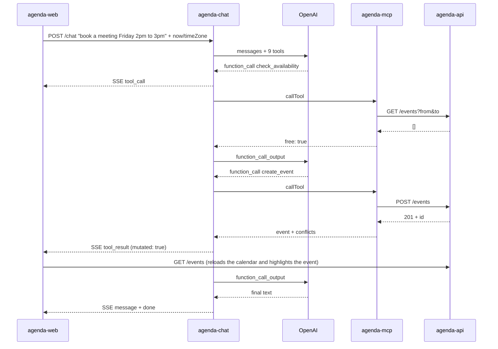

# mcp-poc · Agenda over MCP

Proof of concept of an **MCP server** (Model Context Protocol) that turns an agenda REST API into
*tools* for AI agents, plus a **calendar frontend with a chat** where the user types in natural
language ("jiu-jitsu every Mon, Wed and Fri 7:30pm until the end of the year") and the assistant
carries out the actions by calling those tools.

The same MCP server runs in three places, without changing a line:

- in this repo's **web chat** (OpenAI + its own MCP client);
- in **Claude Code** (`claude mcp add …`);
- in the **MCP Inspector**.



## Contents

- [Architecture](#architecture)
- [Quick start](#quick-start)
- [Packages](#packages)
- [REST API (`agenda-api`)](#rest-api-agenda-api)
- [MCP server (`agenda-mcp`)](#mcp-server-agenda-mcp)
- [Chat (`agenda-chat` + `agenda-web`)](#chat-agenda-chat--agenda-web)
- [Using it in Claude Code and the MCP Inspector](#using-it-in-claude-code-and-the-mcp-inspector)
- [Prompts to try](#prompts-to-try)
- [Tests](#tests)
- [Configuration](#configuration)
- [Design decisions](#design-decisions)
- [Limitations and next steps](#limitations-and-next-steps)

## Architecture

The browser does not talk to MCP directly: the MCP server runs over **stdio** (a local
subprocess), and an LLM decides which tool to call. That is why there is a chat backend in the
middle.



One request from start to finish:



## Quick start

**Requirements:** Node **22** (`nvm use`; see `.nvmrc`), pnpm 10 and an OpenAI key.

```bash
pnpm install
cp .env.example .env      # set OPENAI_API_KEY (or OPENAI_ENV_FILE)
pnpm dev                  # starts api (:3002), chat (:3003) and web (:5174)
pnpm seed                 # in another terminal: 3 sample events
open http://localhost:5174
```

`.npmrc` pins `use-node-version=22.22.2`: `pnpm …` scripts run on that Node even if your shell's
default Node is different (pnpm downloads it on first run).

| Script           | What it does                                                        |
|------------------|---------------------------------------------------------------------|
| `pnpm dev`       | API + chat + web in parallel, in watch mode                         |
| `pnpm dev:api`   | only the API at `http://127.0.0.1:3002` (database `agenda.db`)      |
| `pnpm dev:chat`  | only the chat backend on `:3003` (needs the OpenAI key)             |
| `pnpm dev:web`   | only the frontend at `http://localhost:5174`                        |
| `pnpm dev:mcp`   | the MCP server over stdio (what Claude Code runs)                   |
| `pnpm seed`      | creates 3 events relative to today, over HTTP (the API must be up)  |
| `pnpm inspect`   | opens the MCP Inspector pointed at the server                       |
| `pnpm test`      | tests for every package                                             |
| `pnpm typecheck` | `tsc` for every package                                             |

## Packages

```
packages/
  agenda-api/    agenda REST API (Fastify + SQLite)               → "the API that already existed"
  agenda-mcp/    stdio MCP server, a thin wrapper over the API    → the focus of the POC
  agenda-chat/   chat backend: OpenAI + MCP client + SSE
  agenda-web/    React + Vite: calendar + chat
```

| Package       | Main files                                                                                                     |
|---------------|----------------------------------------------------------------------------------------------------------------|
| `agenda-api`  | `schemas.ts` (Zod, exported for reuse), `repository.ts` (SQL), `app.ts` (routes and errors), `seed.ts`          |
| `agenda-mcp`  | `tools.ts` (CRUD + availability), `batch-tools.ts` (batch and recurrence), `recurrence.ts`, `api-client.ts`, `index.ts` (stdio) |
| `agenda-chat` | `agent.ts` (tool-use loop and confirmation), `app.ts` (HTTP + SSE), `mcp.ts` (spawns the MCP subprocess), `config.ts` |
| `agenda-web`  | `Calendar.tsx`, `Chat.tsx`, `chatClient.ts` (POST + reading the SSE stream)                                     |

`agenda-mcp` imports only schemas and types from the API (`@agenda/api/schemas`), as it would
from a published contract package. All business rules live in the API.

**Stack:** TypeScript strict, pnpm workspaces, Zod 4, Fastify 5, better-sqlite3, Vitest,
`@modelcontextprotocol/sdk` 1.32 (`registerTool`), `openai` 7 (Responses API), React 19,
FullCalendar 6, Vite 8.

## REST API (`agenda-api`)

`Event` entity: `id` (uuid), `title`, `description` (optional), `start`, `end`, `createdAt`,
`updatedAt`.

| Method | Route                  | Notes                                                                                 |
|--------|------------------------|---------------------------------------------------------------------------------------|
| GET    | `/events?from=&to=`    | events overlapping `[from, to)`; optional filters; ordered by start                   |
| GET    | `/events/:id`          | 404 `Event not found with id X`                                                       |
| POST   | `/events`              | 201; 400 with `error` and `details[]`                                                 |
| PATCH  | `/events/:id`          | partial; `description: null` clears it; checks `end > start` after the merge          |
| DELETE | `/events/:id`          | 204                                                                                   |
| POST   | `/events/batch`        | `{ events: [...] }` → 201 `{ events }`; atomic; errors carry the index (`events.3.end`) |
| POST   | `/events/batch/delete` | `{ ids: [...] }` → `{ deleted }`; atomic; 404 lists the missing ids                   |

**Dates:** ISO 8601 **with a timezone** (`Z` or `±hh:mm`, seconds required), e.g.
`2026-11-20T15:00:00-03:00`. The offset you send is kept in the response; comparisons use the
instant (epoch), so `17:00Z` and `14:00-03:00` are the same time. Intervals are half-open: an
event from 2pm to 3pm does not conflict with one from 3pm to 4pm.

**Readable errors**, designed to reach the model as-is:

```bash
curl -s -XPOST localhost:3002/events -H 'content-type: application/json' \
  -d '{"title":"x","start":"2026-11-20T15:00:00-03:00","end":"2026-11-20T14:00:00-03:00"}'
# {"error":"Invalid data — end: end must be after start",
#  "details":[{"field":"end","message":"end must be after start"}]}
```

The API **allows** overlapping events. Conflict detection happens in the MCP server
(`check_availability`), and the create tools return `conflicts` as a warning.

## MCP server (`agenda-mcp`)

stdio transport. The API URL comes from `AGENDA_API_URL` (default `http://localhost:3002`).

| Tool                      | Annotations                                | Output (`structuredContent`)        |
|---------------------------|--------------------------------------------|-------------------------------------|
| `list_events`             | `readOnlyHint`                             | `{ from, to, total, events[] }`     |
| `get_event`               | `readOnlyHint`                             | `{ event }`                         |
| `check_availability`      | `readOnlyHint`                             | `{ free, from, to, conflicts[] }`   |
| `create_event`            | `destructiveHint: false`                   | `{ event, conflicts[] }`            |
| `update_event`            | `destructiveHint: false`, `idempotentHint` | `{ event, conflicts[] }`            |
| `delete_event`            | `destructiveHint: true`, `idempotentHint`  | `{ deleted: true, event }`          |
| `create_recurring_events` | `destructiveHint: false`                   | `{ total, events[], conflicts[] }`  |
| `create_events_batch`     | `destructiveHint: false`                   | `{ total, events[], conflicts[] }`  |
| `delete_events_batch`     | `destructiveHint: true`, `idempotentHint`  | `{ deleted }`                       |

Tool principles:

- **The description is the prompt.** Each one says when to use it, the date format with an
  example, how to convert "tomorrow"/"Friday", and which tool comes first (e.g. "find the id
  with `list_events`"). The server also sends general `instructions` on initialization.
- **Always return ids**, in the text and in `structuredContent`, so the model can chain actions.
- **Errors become `isError: true` with an actionable message**, never a stack trace: `Event not
  found with id X. Use list_events to find the correct id.`, or `Could not connect to the agenda
  API at … Check that it is running (pnpm dev:api)`.
- **Validation before the API:** a date without timezone or an id that is not a UUID never
  reaches `fetch`.
- **Dual response:** `structuredContent` (validated by `outputSchema`) and a `text` with a
  readable summary + JSON, for clients that only read text.
- **Batches instead of repetition:** series and lists are a single call.
  `create_recurring_events` takes weekdays, times and a period, and the server generates the
  dates. Before that, the model created one occurrence per tool call and hit the chat's step
  limit.

## Chat (`agenda-chat` + `agenda-web`)

### Backend (`agenda-chat`, port 3003)

1. On startup it spawns `agenda-mcp` as a **stdio subprocess** (same Node, via
   `--import tsx`), calls `listTools` and converts each tool into an OpenAI *function tool*
   (`inputSchema` → `parameters`), keeping the annotations.
2. For each message it calls `responses.create` with the history, the instructions (with the
   browser's date, time and time zone) and the tools, with `parallel_tool_calls: false`.
3. On a `function_call` it runs `callTool` on the MCP server, appends a `function_call_output`
   and repeats. On text, it stops. The limit is 20 steps; if it is hit, what was done stays
   saved and the user can say "continue".
4. Every step goes to the browser over **SSE**.

| SSE event      | When                                                                       |
|----------------|----------------------------------------------------------------------------|
| `start`        | opens the stream; carries the `conversationId`                             |
| `tool_call`    | the model asked for a tool (name + arguments)                              |
| `tool_result`  | the result; `mutated: true` when the tool is not `readOnlyHint`            |
| `confirmation` | the tool has `destructiveHint`: the loop pauses and waits for the user     |
| `message`      | final text answer                                                          |
| `error`        | readable error (e.g. key rejected, 429)                                    |
| `done`         | closes the stream                                                          |

**Human confirmation, driven by the MCP annotations:** when the model calls a destructive tool
(`delete_event`, `delete_events_batch`), the backend does not run it. It describes the action
with real data, fetched through read-only tools (e.g. `Delete 18 event(s): 18× “Jiu-jitsu”
(Fri, 11/20 → Wed, 12/30)`), and waits for `POST /chat/confirm`. Cancelling, or sending another
message instead, gives the model a `function_call_output` saying the action was **not**
executed.

Routes: `POST /chat` (`{ conversationId?, text, now, timeZone }`), `POST /chat/confirm`
(`{ conversationId, callId, approved, now, timeZone }`) and `GET /chat/health`
(`{ ok, model }`).

The assistant replies in whatever language the user writes in; the code, tools and UI are in
English.

### Frontend (`agenda-web`, port 5174)

- **Calendar** (FullCalendar, day/week/month) that reads `GET /events` straight from the API,
  for display only. Every action goes through the chat.
- **Chat** showing each tool call ("Checked the agenda · Fri, Nov 20 · 3 event(s)"), which
  expands to show arguments and result; a confirmation card for destructive actions; and
  suggested prompts.
- When a tool changes the agenda, the calendar **reloads**, jumps to the date and
  **highlights** the event.
- **Dragging** on the calendar pre-fills "Book an event on Fri, Nov 21 from 2pm to 3pm: ".
  **Clicking** an event pre-fills "About “Daily” (…): ".
- Vite proxies `/api` → `:3002` and `/chat` → `:3003`, so there is no CORS.

## Using it in Claude Code and the MCP Inspector

**Claude Code** (with the API running):

```bash
claude mcp add agenda -e AGENDA_API_URL=http://localhost:3002 -- pnpm --dir /path/to/mcp-poc dev:mcp
```

Check it with `claude mcp list` or `/mcp`. pnpm does not pollute stdout, so JSON-RPC works
through `pnpm --dir`.

**MCP Inspector:**

```bash
pnpm inspect                                   # web UI; the Inspector prints the URL with a token
pnpm exec mcp-inspector --cli -e AGENDA_API_URL=http://localhost:3002 \
  tsx packages/agenda-mcp/src/index.ts --method tools/list
```

The Inspector does not inherit the shell env; the `inspect` script passes `AGENDA_API_URL`
through `-e`.

## Prompts to try

| Prompt                                                           | Expected flow                                                  |
|------------------------------------------------------------------|----------------------------------------------------------------|
| "what do I have tomorrow?"                                       | `list_events` (00:00 tomorrow → 00:00 the day after)           |
| "am I free tomorrow at noon?"                                    | `check_availability` → busy with "Lunch with client"           |
| "book a meeting Friday 2pm to 3pm"                               | `check_availability` → `create_event`                          |
| "book a call tomorrow 1pm to 2pm"                                | creates it and warns about the conflict with lunch             |
| "move Friday's meeting to 4pm"                                   | `list_events` → `update_event` with `start` and `end`          |
| "jiu-jitsu every Mon, Wed and Fri 7:30pm to 8:30pm until Dec 31" | `create_recurring_events` (one call, ~18 events)               |
| "cancel the lunch with client"                                   | `list_events` → confirmation → `delete_event`                  |
| "delete all the jiu-jitsu sessions"                              | `list_events` → one confirmation → `delete_events_batch`       |

## Tests

```bash
pnpm test        # 66 tests: api 27 · mcp 23 · chat 16
pnpm typecheck
```

| Package       | How                                                                              | Covers                                                                                                        |
|---------------|----------------------------------------------------------------------------------|---------------------------------------------------------------------------------------------------------------|
| `agenda-api`  | `app.inject` (Fastify) + SQLite `:memory:`                                        | valid create, end before/equal to start, readable 400, 404, overlap (partial, edge, different time zones), PATCH merge, atomic batch |
| `agenda-mcp`  | SDK `Client` + `InMemoryTransport`, mocked `fetch`                                | catalog and annotations, create, conflict, nonexistent, invalid id, API down, recurrence (expansion, limit, compaction), batch |
| `agenda-chat` | mocked OpenAI (scripted responses) + real in-memory MCP + real in-memory API      | tool conversion, read/write loop, tool error, invalid JSON, step limit, confirmation (approve, cancel, new message cancels), batch, SSE, 401 error |

The frontend is checked with `typecheck` and a build, and was tested end to end in the browser.

## Configuration

The root `.env` is optional and gitignored; see `.env.example`.

| Variable                  | Used by              | Default                 | What it is                                                         |
|---------------------------|----------------------|-------------------------|--------------------------------------------------------------------|
| `OPENAI_API_KEY`          | chat                 | —                       | OpenAI key                                                         |
| `OPENAI_ENV_FILE`         | chat                 | —                       | alternative: path to another `.env`; only `OPENAI_API_KEY` is read |
| `OPENAI_MODEL`            | chat                 | `gpt-5.5`               | Responses API model                                                |
| `OPENAI_REASONING_EFFORT` | chat                 | `low`                   | `minimal` · `low` · `medium` · `high`                              |
| `AGENDA_API_URL`          | mcp, chat, web, seed | `http://localhost:3002` | agenda-api URL                                                     |
| `PORT` / `HOST`           | api                  | `3002` / `127.0.0.1`    |                                                                    |
| `AGENDA_DB`               | api                  | `agenda.db`             | SQLite path (`:memory:` works)                                     |
| `CHAT_PORT`               | chat                 | `3003`                  |                                                                    |
| `WEB_PORT`                | web                  | `5174`                  |                                                                    |
| `SEED_OFFSET`             | seed                 | `-03:00`                | time zone of the sample events                                     |

## Design decisions

- **MCP as a thin wrapper.** Validation and rules live in the API. The MCP server translates to
  tools, improves messages for the model and only has its own logic where it is about the agent
  interface: conflict detection, recurrence expansion and compacting long lists.
- **Overlaps allowed in the API.** Real agendas have conflicts; the agent warns instead of
  blocking.
- **Recurrence without a stored rule.** `create_recurring_events` generates independent events
  with a fixed offset (Brazil has had no daylight saving time since 2019). Storing rules
  (RRULE) was out of scope.
- **Confirmation in the MCP client, driven by `destructiveHint`.** The server declares the risk
  and whoever hosts the agent decides how to confirm. Here, a card in the chat.
- **One tool at a time** (`parallel_tool_calls: false`): makes pausing for confirmation simple
  and keeps the history linear.
- **Node 22.** Current versions of Fastify (light-my-request), Vite/Vitest and the Inspector
  need `require(esm)` / Node ≥ 22. Node 20 has been out of support since April 2026.
- **Inspector pinned to 2.13.0:** 2.14 onwards requires Node ≥ 22.23.4.

## Limitations and next steps

- Chat conversations live in memory: restarting `agenda-chat` wipes the history.
- No auth and no multi-user; MCP transport is stdio only.
- The answer text arrives all at once (per-token streaming is not implemented yet).

**TODO: expose MCP over HTTP with OAuth**

- **Transport:** replace `StdioServerTransport` with Streamable HTTP
  (`StreamableHTTPServerTransport`) on an `/mcp` endpoint; choose between stateless and sessions
  with `Mcp-Session-Id`; validate `Origin` (DNS rebinding); serve over HTTPS only.
- **OAuth 2.1 (MCP authorization spec):** the MCP server becomes a *resource server*; publish
  `/.well-known/oauth-protected-resource` (RFC 9728); answer `401` with `WWW-Authenticate`;
  validate the bearer on every request (signature, expiry, `aud`/resource indicator RFC 8707);
  PKCE; client registration via Client ID Metadata Documents or Dynamic Client Registration.
- **Per-tool scopes:** `agenda:read` (list/get/check) and `agenda:write`
  (create/update/delete).
- **No token passthrough:** do not forward the MCP client's token to the API; use token
  exchange or a dedicated credential, propagating the user's identity.
- **Multi-user API:** `owner_id` on events, filtered by user in every query.
- **Operations:** rate limiting, auditing of destructive tools, health checks, retries and
  deployment.
